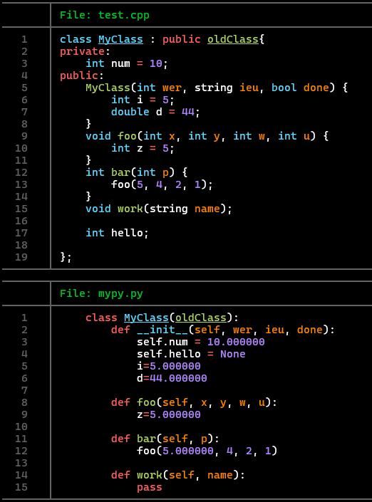
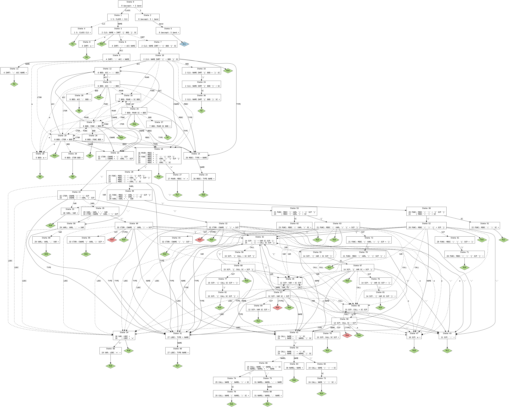

# CPPy-Class

> A command-line tool that parses C++ header files and generates equivalent Python class definitions using Flex and Bison.

#### Output


#### Tree


## About the Project
This project was developed for a compilers course to gain a practical understanding of lexical analysis and parsing. The primary objective was to build a compiler front-end that can process a subset of the C++ language. It uses Flex to tokenize C++ class syntax and Bison to parse these tokens into an Abstract Syntax Tree (AST), which is then traversed to generate semantically equivalent Python code.

This tool demonstrates a foundational knowledge of compiler design, context-free grammars, and the complexities of translating between statically-typed and dynamically-typed object-oriented languages.

## Tech Stack 🛠️
C++: For the core logic and AST manipulation.

Flex: For lexical analysis (tokenizing the C++ source code).

Bison: For parsing the token stream and building the AST.

Make: For automating the build process.

## Key Features
Parses C++ class declarations from .h header files.

Recognizes member variables with basic types (int, double, std::string, etc.) and maps them to Python equivalents.

Handles simple inheritance structures (class Derived : public Base).

Generates clean, corresponding .py files with Python class structures, including an \_\_init__ method and pass for member functions.

## Getting Started
Install Dependencies
- On Debian/Ubuntu:
  ```bash
  sudo apt-get install flex bison g++ make
  ```
- On Fedora/CentOS/RHEL(dnf/yum):
  ```bash
  sudo dnf install flex bison g++ make
  ```
Clone the repository
  ```bash
  git clone https://github.com/JoWatersASC/CPPy-Class
  cd CPPy-Class
  ```

## Build
  ```bash
  bash build.sh
  ```
  or on Linux
  ```bash
  chmod +x build.sh
  ./build.sh
  ```
## Run
  ```bash
  cd output
  cppygen <cpp_input_file> [<python_output_file>]
  ```
  and <python_output_file> should contain your new class! 
  ***(If no <python_output_file> specifed, default name is CPPy-Class.py)***
  
  *If you want to not have the parser output, do*
  ```bash
  cd output
  cppygen <cpp_input_file> [<python_output_file>] 2> <temp_file>
  ```
  and all the parser output will be placed into <temp_file>
 

#### **BNF Format:**

\<program\> ::= \<class\_decl\>+  
\<class\_decl\> ::= "class" \<identifier\> "{" \<member\>\* "}"   
\<member\> ::= \<access\_specifier\> \<identifier\> ";"  
\<access\_specifier\> ::= "public" | "private" | "protected"  
\<identifier\> ::= \[A-Za-z\_\]\[A-Za-z0-9\_\]\*

#### **Coverage Explanation:**

This grammar captures the basic structure of a C++-like class system including:

* Class declarations

* Access specifiers (public, private, protected)

* Member identifiers

This simple structure supports hierarchical parsing of class definitions.

---

#### **Parsing Strategy:**

We use a **LALR(1) bottom-up parsing** approach via **Bison** to match token streams from the lexer. The strategy handles nested rules efficiently and supports lookahead for disambiguation.

#### **Fit for Use Case:**

Our language is structured and declarative (class-based), which fits naturally into LALR parsing. It avoids deep recursion, making LALR a good performance fit.

#### **Source Code:**

* **Lexer (Flex):** Tokenizes input source using regex patterns.

* **Parser (Bison):** Processes tokens and builds class structure.

* Outputs are prepared to reflect syntax trees and potential intermediate code.

---

### **3\. Executable Program with Use Case \[20 pts\]**

#### **Flow:**

Input (C++-style class source)  
     ↓  
Lexical Analysis (Flex)  
     ↓  
Parsing (Bison)  
     ↓  
Syntax Tree / Structured Output

#### **Use Case:**

Parses class definitions from a source file and outputs structured JSON representing class structure. For example:

class Shape {  
  public area;  
  private size;  
};

→

{  
  "class": "Shape",  
  "members": \[  
    {"access": "public", "name": "area"},  
    {"access": "private", "name": "size"}  
  \]  
}

---

#### **Assumptions:**

* All class declarations are syntactically valid.

* Every member must be followed by a semicolon.

* No function definitions or expressions are allowed (identifier declarations only).

#### **Language Objectives:**

* Simplify and validate object-oriented structure

* Provide a stepping stone for more complex C++-like features

* Enable structured output (e.g., for transpilation or analysis)